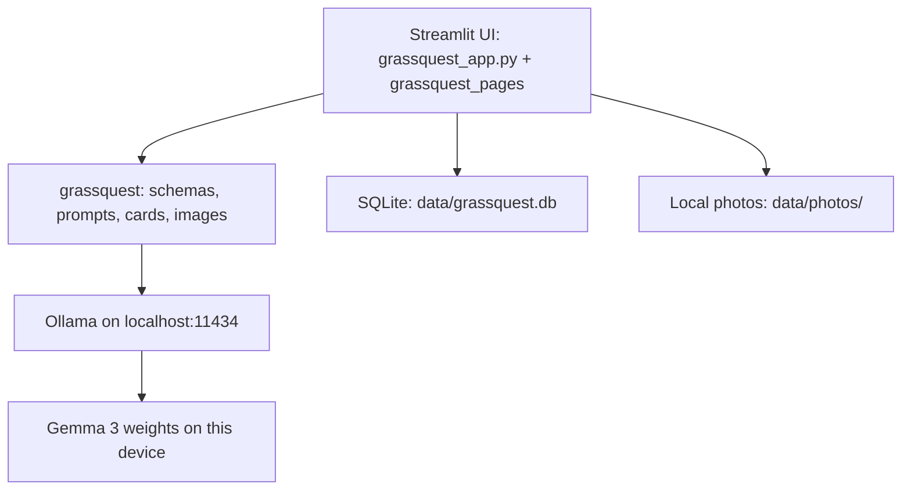

# GrassQuest 🌿

**Plan a tiny outdoor adventure, print it, put your phone away, and keep a local trail journal.**

   

## Why I built this

After a day at a screen, people often want to go outside but cannot think of a reason to start. Then a phone comes along and the walk turns into more scrolling. GrassQuest makes the screen the shortest part: make a card, print it, and leave the phone behind. The best outdoor tool is one you barely need to look at.

## Features

- Generate eight safe, season- and place-aware outdoor tasks adapted to group, time, difficulty and accessibility notes.
- Download a self-contained printable HTML card or Markdown version.
- Save quests, tick off tasks, mark a walk done and remove old plans.
- After the walk, optionally check up to six photos with a local vision model and draft/edit a first-person journal.
- Export all journals as Markdown; load fictional demo data.
- SQLite, photos, and model inference stay on the device.

## Screenshots and demo

Add screenshots at `docs/screenshots/home.png`, `quest-card.png`, `my-quests.png`, and `journal.png`.

**Demo video:** _add your video link here_

## Tech stack and architecture



Python 3.10+, Streamlit for the small multi-page UI, Pydantic for quest validation, Ollama's official Python client for local text and vision inference, SQLite for zero-setup storage, and Pillow to resize photos before inference. A tiny model-generated theme is combined with safe, validated local task templates to keep quest generation quick. There are no cloud API calls.

## Prerequisites

- Python 3.10 or newer
- Ollama installed and running
- About 8 GB RAM recommended for `gemma3:4b`; photo checking requires a vision-capable model.

## Install and run

Install Ollama from [ollama.com/download](https://ollama.com/download), then in a terminal:

```bash
ollama pull gemma3:4b
ollama list
git clone https://github.com/vaibhavi897/grassquest.git
cd grassquest
```

Windows PowerShell:

```powershell
python -m venv .venv
.\.venv\Scripts\Activate.ps1
pip install -r requirements.txt
streamlit run grassquest_app.py
```

macOS / Linux:

```bash
python3 -m venv .venv
source .venv/bin/activate
pip install -r requirements.txt
streamlit run grassquest_app.py
```

## Usage

1. Pick season, general place type, group, time and difficulty; add an optional access note and generate.
2. Preview and download the HTML/Markdown card; print it before leaving.
3. Put your phone away and follow the paper checklist outdoors.
4. Back home, tick completed tasks, optionally upload a few photos, and ask the local model to check them.
5. Draft and edit the journal, save it locally, and export journal entries as Markdown.

## Configuration

Defaults are `GRASSQUEST_MODEL=gemma3:4b`, `OLLAMA_HOST=http://localhost:11434`, and `GRASSQUEST_DB_PATH=data/grassquest.db`. Set these environment variables before launch or choose a model in Settings. `gemma3:1b` is a lower-RAM text-only fallback; photo checking needs a vision-capable model.

## Tests and vision evaluation

```bash
pytest
python scripts/eval_vision.py path/to/your/photos --task "Notice a patch of light and shadow"
```

Use your own photos for the evaluation; the app does not include real sample images.

## Limitations

A small vision model can misread images. Its output is labelled **AI guess, may be wrong**; never rely on a species guess as a fact. Generated quests are suggestions, not a replacement for local safety judgment, weather awareness, access needs or common sense. If the model is unavailable or slow, the app uses a generic title and builds the card from local templates.

## Troubleshooting

- **Ollama unavailable:** start it with `ollama serve` or launch the Ollama desktop app.
- **Model missing:** run `ollama pull gemma3:4b` (or the model selected in Settings).
- **Slow generation:** close heavy apps or use a smaller text model for quest writing; keep a vision-capable model selected for photo checks.
- **Port 8501 in use:** run `streamlit run grassquest_app.py --server.port 8502`.
- **Vision unsupported:** use a multimodal model such as `gemma3:4b`; `gemma3:1b` is text-only.
- **Corrupt/oversized photo:** use a readable JPG, PNG or WEBP under 15 MB.

## Why open-source AI matters here

After the model is downloaded, the printed card works on the trail with no signal. Photos never leave the device; there are no accounts, API keys or per-request fees. You can switch the local model without rewriting the app, and every safety/honesty prompt is readable in `grassquest/prompts.py` and can be edited to suit the project.

## Privacy

Quest details and journal entries live in `data/grassquest.db`; resized photos live under `data/photos/`. No GPS or location API is used; only a general place type is requested. Inference targets Ollama at `localhost:11434`. No external services receive notes, photos or location.

## Roadmap

- Voice notes transcribed locally with Whisper
- Optional local bird-call listening model
- Shareable printable quest cards

## License and acknowledgements

MIT License. Built with [Gemma](https://ai.google.dev/gemma), [Ollama](https://ollama.com) and [Streamlit](https://streamlit.io).
